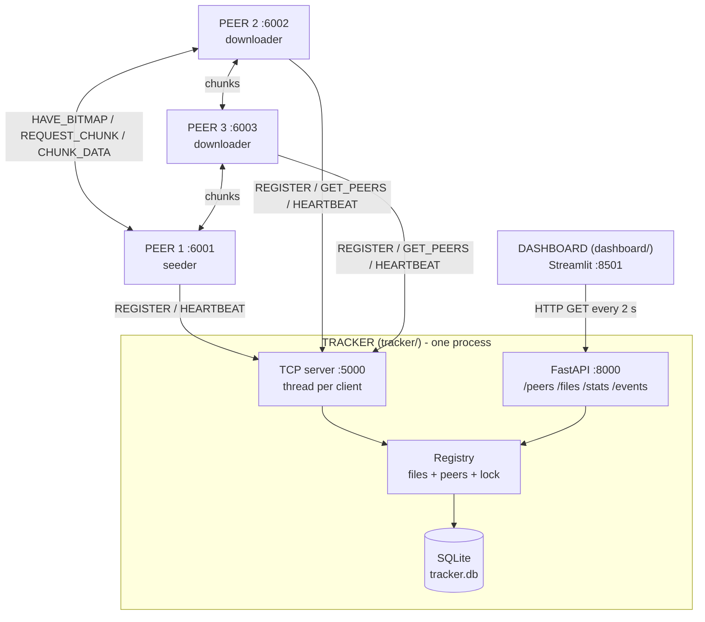
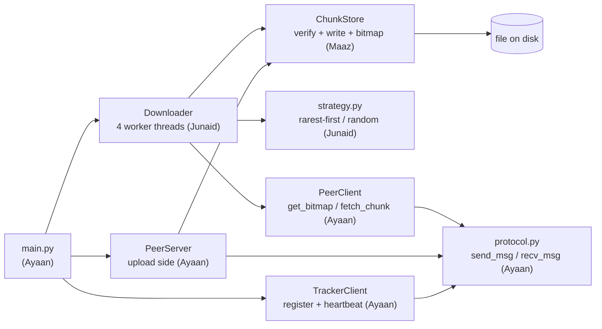
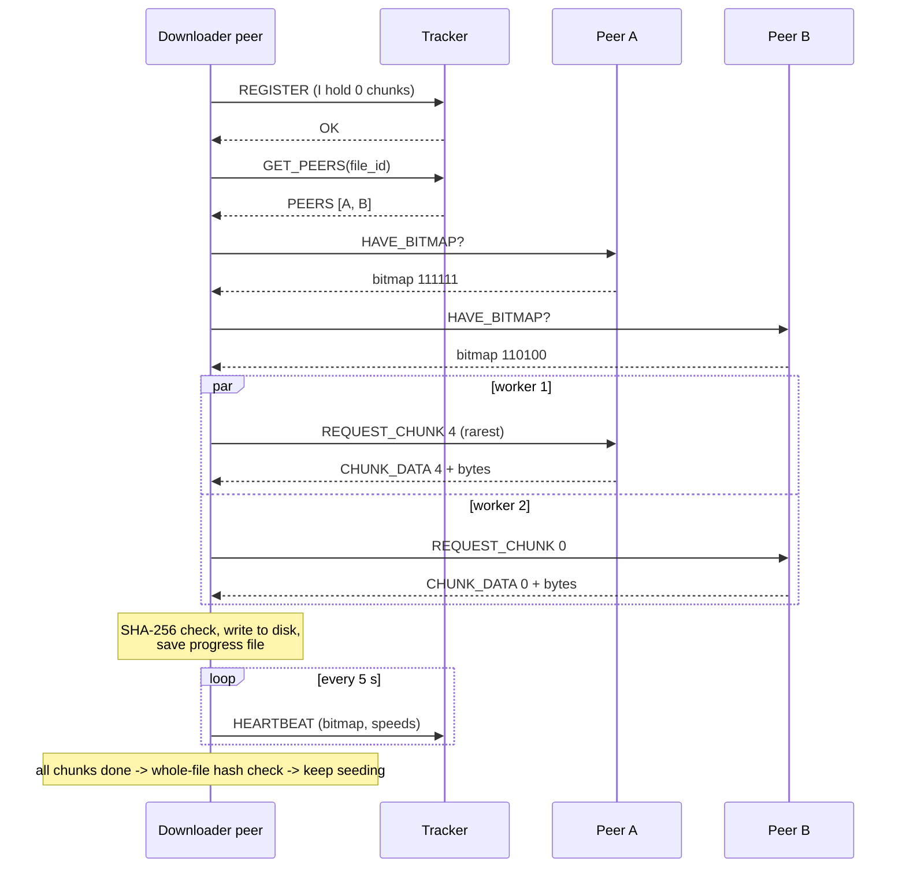

# MiniTorrent Architecture

## 1. The big picture



Two models in one project:

- **Client-server:** peer ↔ tracker. The tracker only stores *who has what*. No file byte ever passes through it.
- **Peer-to-peer:** peer ↔ peer. File data travels directly between peers over TCP. Every peer is a server (uploads) and a client (downloads) at the same time.

## 2. Inside one peer



The `ChunkStore` is the meeting point: the download workers write into it while the upload server reads from it, so it has its own lock.

## 3. Wire format (framing)

TCP is a byte stream with no message boundaries, so every message is framed:

```
+------------------+------------------------------+---------------------------+
| 4 bytes          | N bytes                      | payload_len bytes         |
| length N         | JSON header (UTF-8)          | raw chunk data (optional) |
| big-endian '>I'  | {"type": "...", ...}         | only if header has        |
|                  |                              | "payload_len"             |
+------------------+------------------------------+---------------------------+
```

The receiver reads exactly 4 bytes, then exactly N bytes, then exactly `payload_len` bytes. `recv_exact()` loops because `recv()` may return fewer bytes than requested.

## 4. Messages

| Message | Direction | Important fields | Reply |
|---|---|---|---|
| `REGISTER` | peer → tracker | file_id, name, size, num_chunks, port, bitmap, chunks_held | `OK` |
| `HEARTBEAT` | peer → tracker | same as REGISTER plus uploaded, downloaded, extra | `OK` |
| `GET_PEERS` | peer → tracker | file_id, port | `PEERS` {peers: [{ip, port, chunks_held}]} |
| `HAVE_BITMAP` | peer → peer | file_id | `HAVE_BITMAP` {bitmap: [1,0,1,...]} |
| `REQUEST_CHUNK` | peer → peer | file_id, index | `CHUNK_DATA` {index, hash, payload_len} + raw bytes |
| `ERROR` | any | reason | - |

Example of one chunk request on the wire:

```
-> <4-byte length> {"type": "REQUEST_CHUNK", "file_id": "8f2b...", "index": 12}
<- <4-byte length> {"type": "CHUNK_DATA", "index": 12, "hash": "a3f1...", "payload_len": 262144}
   <262144 raw bytes>
```

## 5. The `.mtorrent` metadata file

```json
{
  "name": "movie.mp4",
  "size": 52428800,
  "chunk_size": 262144,
  "num_chunks": 200,
  "hashes": ["<sha256 of chunk 0>", "<sha256 of chunk 1>", "..."],
  "file_id": "<sha256 of all the hashes joined together>",
  "file_hash": "<sha256 of the whole file>"
}
```

The downloader trusts this file and nothing else. A chunk is accepted only if its SHA-256 equals `hashes[i]`.
`file_hash` is one extra field on top of the original plan. It allows the final whole-file check.

## 6. Life of a download



## 7. The download engine

Shared state, all protected by **one lock**:

| Field | Meaning |
|---|---|
| `needed` | chunks still to download |
| `in_progress` | chunks a worker is fetching right now |
| `peer_chunks` | which chunks each peer holds |
| `load` | open requests per peer |
| `banned` | peers to avoid, with an expiry time |

Each of the 4 workers repeats:

1. **Lock.** Candidates = `needed − in_progress`, limited to chunks that a non-banned peer with a free slot holds.
2. The **strategy** picks one chunk (rarest-first = fewest holders).
3. Pick the **least busy** peer that holds it. Add the chunk to `in_progress`. **Unlock.**
4. Fetch over the network (no lock held, so workers really run in parallel).
5. Verify SHA-256 and write. On success remove from `needed`, save the progress file.
6. On timeout or bad hash: put the chunk back and **ban** that peer for 10 s. Another peer serves it.

Because a chunk is added to `in_progress` under the lock, two workers can never download the same chunk.

## 8. Fault tolerance

| Failure | Detected by | What happens |
|---|---|---|
| Peer dies mid-download | connection error or 5 s timeout | chunk goes back to the pool, peer banned 10 s, other peers serve it |
| Peer dies (tracker view) | no heartbeat for 15 s | reaper thread removes it, dashboard shows "LOST" |
| Corrupted or tampered chunk | SHA-256 mismatch | chunk rejected, never written, re-fetched elsewhere |
| Downloader crashes | - | `.progress` file lists finished chunks. On restart each is re-hashed from disk, only the rest is downloaded |
| Tracker restarts | - | registry is reloaded from SQLite, peers get one timeout period to heartbeat again |
| Nobody has the remaining chunks | no progress for 30 s | download stops cleanly, progress is kept for a later resume |

## 9. Threads

| Process | Threads |
|---|---|
| Tracker | accept loop, one per client connection, reaper (every 1 s), uvicorn (HTTP) |
| Peer | accept loop, one per incoming connection, heartbeat, peer refresher, 4 download workers |
| Dashboard | Streamlit, redraws one fragment every 2 s |

## 10. Design decisions worth defending

- **Length-prefix framing instead of a delimiter:** chunk data is binary and can contain any byte, so a delimiter such as `\n` could appear inside the data.
- **JSON header + raw payload:** JSON is easy to read in Wireshark. Putting 256 KB of binary inside JSON would need base64 and add 33 % overhead.
- **One request per TCP connection on the client side:** simplest correct design, and a dead peer is detected immediately at connect time.
- **256 KB chunks:** small enough that a failed chunk is cheap to re-download, large enough that a 50 MB file has only 200 hashes.
- **Rarest-first:** rare chunks are the ones most likely to be lost if a peer leaves, and the peers holding them are the bottleneck. Fetching them first keeps every source busy.
- **Tracker stores no file data:** it stays tiny, and killing it does not stop transfers that are already running between peers.
