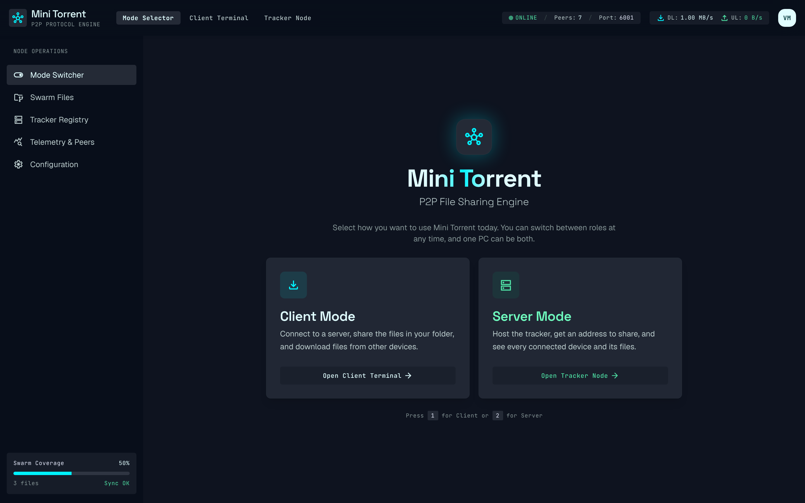
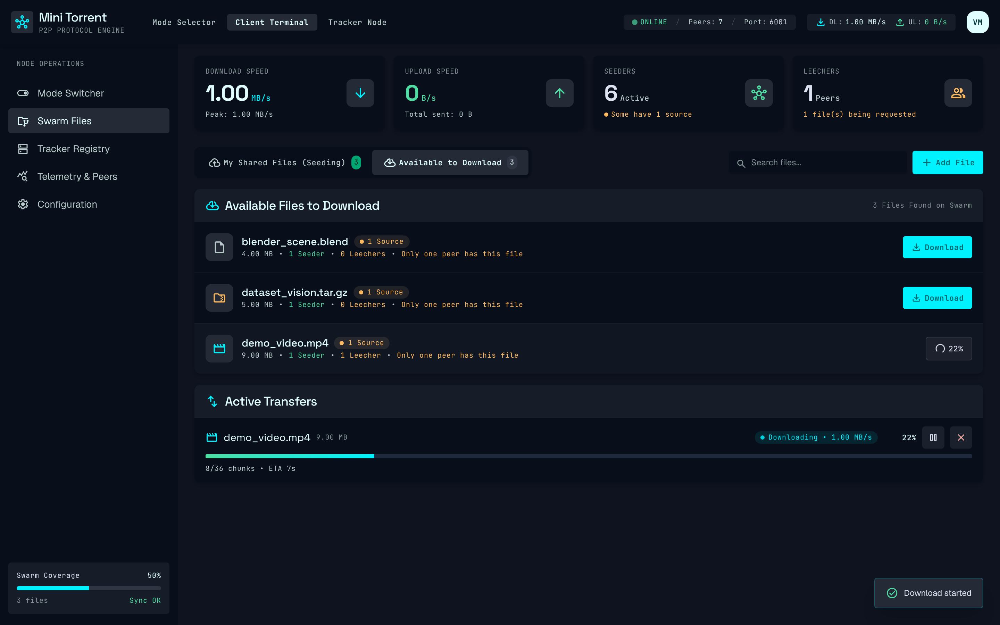
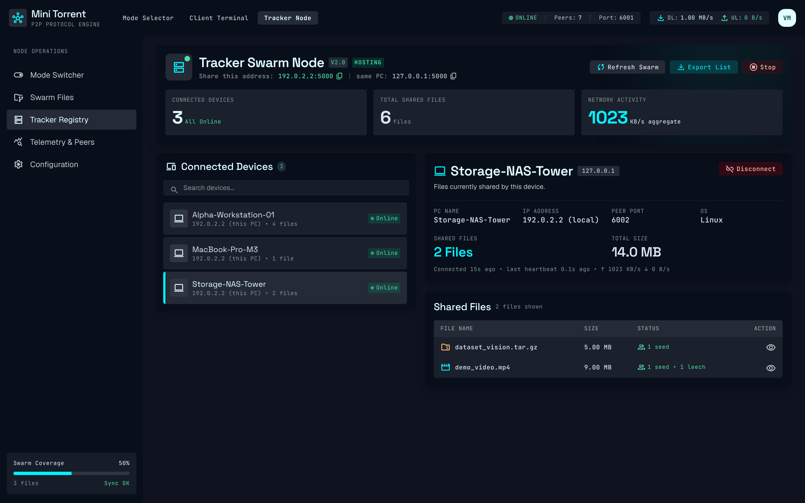

# 🧲 MiniTorrent

**A deployable peer-to-peer file sharing system in Python** — CN Lab Project, Group 1

A small, working BitTorrent-style system. A lightweight **tracker** helps peers find each other. Each **peer** splits files into 256 KB chunks, downloads different chunks from several peers **in parallel**, verifies every chunk with **SHA-256**, and uploads the chunks it already has. A **desktop-style web UI** (title screen, client screen, server screen) shares whole folders and shows the whole swarm.

<p align="center">
  <a href="https://github.com/JuniJaved01/Minitorrent/releases/tag/beta">
    
  </a>
</p>

| Title | Client | Server |
|---|---|---|
|  |  |  |

| | |
|---|---|
| Architecture and protocol | [ARCHITECTURE.md](ARCHITECTURE.md) |
| Who owns which file | [docs/WORK_DISTRIBUTION.md](docs/WORK_DISTRIBUTION.md) |
| Per-member study notes and viva questions | [docs/briefs/](docs/briefs/) |

---

## 1. The app (recommended)

Requires **Python 3.10+**. No Node.js, no Docker, no internet needed (fonts are bundled).

```bash
cd minitorrent
pip install -r requirements.txt
python -m ui
```

Your browser opens **http://localhost:8080** with the title screen. Pick a role:

| Role | What you do | What happens |
|---|---|---|
| **Server** | Press *Start hosting* (port 5000) | This PC runs the tracker. The screen shows an address such as `192.168.1.10:5000` to share, every connected device (PC name, IP, online/offline) and the files in each device's shared folder. The server never stores the files. |
| **Client** | Type the server address and port, press *Test connection*, choose a shared folder, press *Connect* | Every file in your folder is hashed and seeded. *Available to Download* lists everyone else's files with seeders and leechers; downloads are saved into your folder and seeded straight away. |

One PC can be server and client at the same time (host on the Server screen, then connect the Client screen to `127.0.0.1:5000`).

**Colours on the client:** green = 2 or more peers have the file, amber = only one peer has it, **red** = the download is
running below 100 KB/s, or no online peer has all of its pieces (it cannot finish until someone with the file comes back).

### Which address do I share?

| Address | Who can connect |
|---|---|
| `127.0.0.1:5000` (localhost) | Only programs on the same PC. Use it to test with several client windows. |
| `192.168.x.x:5000` (LAN IP, shown on the Server screen) | Anyone on the same Wi-Fi / LAN. Allow Python through the firewall when Windows asks (tick *Private networks*). |
| Internet | A LAN address does not work from outside. Use a VPN such as Tailscale/ZeroTier, or port forwarding on the router. |

### Several clients on one PC (for testing)

Each client needs its own UI window and its own folder:

```bash
python -m ui                 # window 1  -> http://localhost:8080  (Server, and optionally a client)
python -m ui --port 8081     # window 2  -> http://localhost:8081  (Client with folder A)
python -m ui --port 8082     # window 3  -> http://localhost:8082  (Client with folder B)
```

Peer ports are picked automatically from 6001 upwards. Useful options: `--name "My-Laptop"`, `--serve 5000`
(host immediately), `--connect 127.0.0.1:5000 --folder ~/MT` (connect immediately), `--no-browser`.

## 1b. Quick demo (one command)

```bash
python run_demo.py
```

This starts the UI in Server mode, one seeder and two downloaders (command-line peers), and opens
**http://localhost:8080/#/server**. Open *Telemetry & Peers* to watch the chunk maps fill.
Press `Ctrl+C` to stop everything. On Windows you can also double-click `run_demo.bat`.

| Demo | Command | What you see |
|---|---|---|
| Swarm | `python run_demo.py` | 1 seeder, 2 empty peers. The grids fill up, and the two downloaders also trade chunks with each other. |
| Fault tolerance | `python run_demo.py --scenario failover` | 3 seeders, 1 downloader. After 7 s one seeder is killed. The download still finishes and the hash is verified. |

Useful options: `--size 50` (file size in MB), `--delay 0.5` (slower, easier to watch), `--kill-after 10`.

> The demo slows uploads down on purpose (`--delay`) because on one laptop a 20 MB file would finish in under a second. It also uses a 1 s heartbeat and a 6 s timeout so you are not waiting in front of the teacher. The real defaults are 5 s and 15 s.

## 2. Running it by hand (command line, no UI)

Open one terminal per line, all inside the project folder.

```bash
# 1) tracker: TCP port 5000 for peers, HTTP port 8000 for the dashboard
python -m tracker.server --port 5000 --api-port 8000

# 2) optional legacy dashboard (Streamlit): http://localhost:8501
streamlit run dashboard/app.py

# 3) a seeder: shares a file and writes movie.mp4.mtorrent next to it
python -m peer.main --tracker 127.0.0.1:5000 --port 6001 --share movie.mp4

# 4) a downloader: needs only the small .mtorrent file
python -m peer.main --tracker 127.0.0.1:5000 --port 6002 --download movie.mp4.mtorrent
```

The download is saved to `downloads/<port>/<name>`. After finishing, the peer keeps seeding. If you stop a downloader and start it again with the same command, it **resumes**.

Peer options: `--out PATH`, `--strategy rarest|random`, `--upload-delay SECONDS`, `--exit-when-done`.

## 3. Running on several laptops (same Wi-Fi)

**With the UI (easiest):**

1. The host laptop runs `python -m ui`, picks **Server** and presses *Start hosting*. The screen shows the address to share, for example `192.168.1.10:5000`.
2. Every other laptop runs `python -m ui`, picks **Client**, types `192.168.1.10` and port `5000`, presses *Test connection*, chooses its own shared folder and presses *Connect*.
3. Nothing else to copy: files are listed by the server and their metadata comes straight from the peers.

**Command line only:**

1. One laptop runs the tracker. Find its IP with `ipconfig` (Windows) or `ip addr` (Linux), for example `192.168.1.10`.
2. Everyone else starts peers with `--tracker 192.168.1.10:5000`.
3. Copy the `.mtorrent` file to the downloaders (USB, WhatsApp, anything. It is only a few KB).
4. For the legacy dashboard on another laptop: `MT_API_URL=http://192.168.1.10:8000 streamlit run dashboard/app.py`.

## 4. Docker

```bash
docker compose up --build
```

Starts tracker + dashboard + 1 seeder + 2 downloaders. Open http://localhost:8501.

## 5. Ports and firewall fixes

| Port | Protocol | Used by |
|---|---|---|
| 5000 | TCP (our protocol) | peers → tracker |
| 8080, 8081, ... | HTTP, **127.0.0.1 only** | browser → MiniTorrent UI (never reachable from other PCs) |
| 8000 | HTTP | legacy dashboard → tracker API (`python -m tracker.server` only) |
| 8501 | HTTP | browser → legacy Streamlit dashboard |
| 6001, 6002, ... | TCP (our protocol) | peer ↔ peer, one port per peer |

If peers on other laptops cannot connect:

- **Windows:** when the "Windows Defender Firewall" popup appears, tick **Private networks** and click *Allow access*. If you missed it, run in an Administrator terminal:
  `netsh advfirewall firewall add rule name="MiniTorrent" dir=in action=allow protocol=TCP localport=5000,8000,8501,6001-6010`
- **Linux:** `sudo ufw allow 5000,8000,8501,6001:6010/tcp`
- **University / hostel Wi-Fi** often blocks device-to-device traffic ("client isolation"). Use a mobile hotspot instead.
- "Address already in use": another program has the port. Pick another `--port`, or close the old terminal.
- Across the internet you need port forwarding or a VPN such as Tailscale.

## 6. Tests and experiments

```bash
pytest -v                               # 29 tests, about 7 seconds
python -m experiments.run_experiment    # random vs rarest-first with 2, 3, 4 peers -> CSV
python -m experiments.plot_results      # CSV -> experiments/results/strategy_vs_peers.png
```

The tests cover: folder sharing, metadata download, device list and disconnect (`tests/test_node.py`), split and reassemble, a flipped byte, file sizes that are not a multiple of 256 KB, a 50 MB file, message framing, a 3-seeder parallel download, **killing a peer mid-download**, **a peer sending corrupted chunks**, and **resume**.

Sample result (one run on one machine; run it yourself for the report):


## 7. Settings (environment variables)

| Variable | Default | Meaning |
|---|---|---|
| `MT_CHUNK_SIZE` | 262144 | chunk size in bytes |
| `MT_TRACKER_HOST` / `MT_TRACKER_PORT` | 127.0.0.1 / 5000 | tracker address |
| `MT_API_PORT` | 8000 | tracker HTTP API port |
| `MT_HEARTBEAT` | 5 | seconds between heartbeats |
| `MT_PEER_TIMEOUT` | 15 | tracker forgets a silent peer after this many seconds |
| `MT_SOCKET_TIMEOUT` | 5 | network call timeout |
| `MT_WORKERS` | 4 | parallel download threads |
| `MT_MAX_PER_PEER` | 2 | parallel requests to one peer |
| `MT_UPLOAD_DELAY` | 0 | fake seconds per uploaded chunk |
| `MT_API_URL` | http://127.0.0.1:8000 | where the dashboard finds the tracker |
| `MT_REFRESH` | 2 | dashboard refresh in seconds |

## 8. Project structure

```
minitorrent/
  common/       config.py, protocol.py                      Ayaan
  peer/         network.py, main.py                         Ayaan
                chunks.py                                   Maaz
                downloader.py, strategy.py                  Junaid
  tracker/      registry.py, server.py, storage.py, api.py  Arbab
  dashboard/    app.py (legacy Streamlit, used by Docker)   Hamza
  ui/           app.py, __main__.py, static/ (the UI)       new
  peer/node.py  folder-sharing client used by the UI        new
  tests/        test_*.py, helpers.py                       Maaz
  experiments/  run_experiment.py, plot_results.py          Junaid
  tools/        make_test_file.py                           Maaz
  run_demo.py, Dockerfile, docker-compose.yml,
  requirements.txt, README.md                               Hamza
```

## 9. Team

| Member | Roll No. | Module |
|---|---|---|
| Arbab Rahim Ullah Jan | 22I-2726 | Tracker and storage |
| Muhammad Maaz | 22P-9040 | Chunking, integrity and tests |
| Mian Muhammad Ayaan | 22P-9149 | Protocol and peer networking |
| Muhammad Junaid Javed Khan | 22P-9163 | Download engine |
| Muhammad Hamza Khan | 22P-9178 | Dashboard, setup and report |

## 10. Changing the UI

The page is plain HTML + JavaScript in `ui/static/` (`index.html`, `app.js`). Styles are Tailwind classes compiled
into `ui/static/app.css`. If you add new classes, rebuild once with Node.js installed: `ui/tailwind/build.sh`
(Windows: `ui\tailwind\build.bat`). The icon font in `ui/static/fonts/` only contains the icons the UI uses;
to add an icon, re-download the subset from Google Fonts with `&icon_names=` (see `fonts.css`).