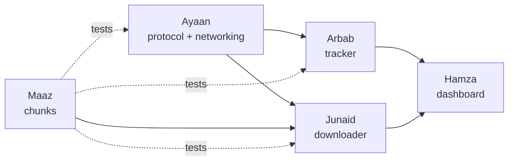

# Work distribution

One repo, **one owner per file**. Edit only your own files. If you need a change in someone else's file, ask the owner.

| Member | Module | Files | Lines of code |
|---|---|---|---|
| **Ayaan** | Protocol and peer networking | `common/config.py`, `common/protocol.py`, `peer/network.py`, `peer/main.py` | ~460 |
| **Arbab** | Tracker and storage | `tracker/registry.py`, `tracker/server.py`, `tracker/storage.py`, `tracker/api.py` | ~415 |
| **Maaz** | Chunking, integrity and tests | `peer/chunks.py`, `tests/` (5 files), `tools/make_test_file.py`, `conftest.py` | ~595 |
| **Junaid** | Download engine | `peer/downloader.py`, `peer/strategy.py`, `experiments/` (2 files) | ~370 |
| **Hamza** | Dashboard, setup and report | `dashboard/app.py`, `run_demo.py`, `run_demo.bat`, `Dockerfile`, `docker-compose.yml`, `requirements.txt`, `.streamlit/`, `README.md`, final report | ~475 + docs |

## Is it fair?

Yes, close enough that nothing was moved between people. Line counts differ, but difficulty evens it out:

- **Junaid** has the fewest lines and the hardest logic (threads, one lock, retries, resume).
- **Maaz** has the most lines, but most of them are tests, which are simple to read.
- **Hamza** has code plus the README, demo material and the final report.
- **Ayaan** and **Arbab** sit in the middle with one clear subsystem each.

Small balancing choices made while building:

- The experiment **plot script** went to Junaid (it is his data), not Hamza.
- Tests for the protocol, tracker and strategies went to Maaz, so he can speak about the whole system's correctness.
- SQLite got its own small file (`tracker/storage.py`) so Arbab can explain persistence separately.

## Note: the proposal PDF and the plan disagree

The proposal PDF lists **Maaz = peer networking** and **Ayaan = chunking**. The newer plan has them the other way round. This repo follows the **newer plan** (Ayaan = networking, Maaz = chunking). If the teacher marks from the PDF, either tell her about the swap or swap the two briefs. The code does not care.

## How the modules depend on each other

## What is still left for humans

The code is complete and tested. These need a person:

| Who | Task |
|---|---|
| Junaid | Create the GitHub repo, push this code, add the other four as collaborators |
| Everyone | Read your own files line by line (every line has a comment) and your brief in `docs/briefs/` |
| Everyone | Run `python run_demo.py` on your own laptop |
| Junaid | Run the experiment on a laptop and give the CSV + graph to Hamza |
| Ayaan | Wireshark capture of the protocol (steps in his brief) |
| Arbab | Show the kill-a-peer timeout and the SQLite restart (steps in his brief) |
| Maaz | Run `pytest -v`, screenshot the result for the report |
| Hamza | Test `docker compose up --build`, take dashboard screenshots, assemble the report and slides |
